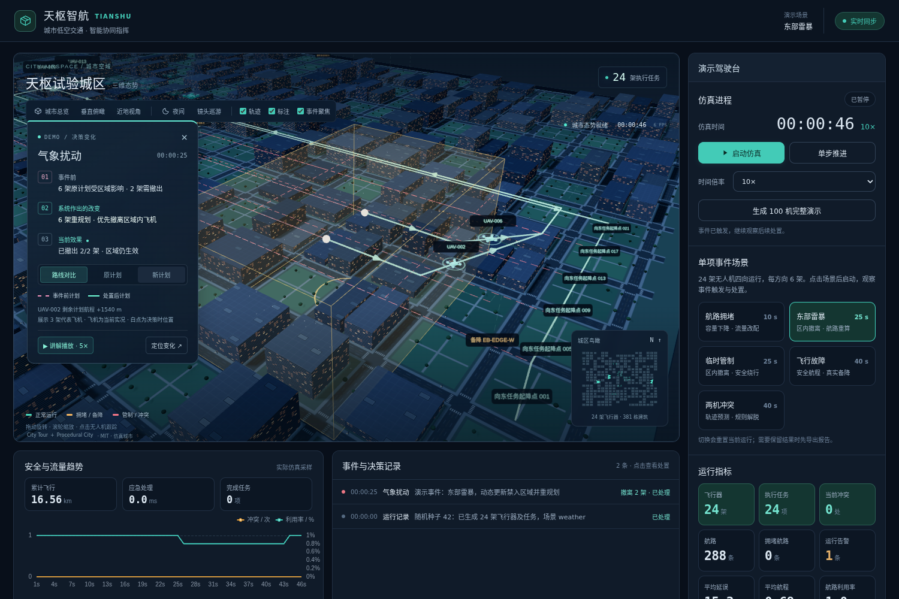
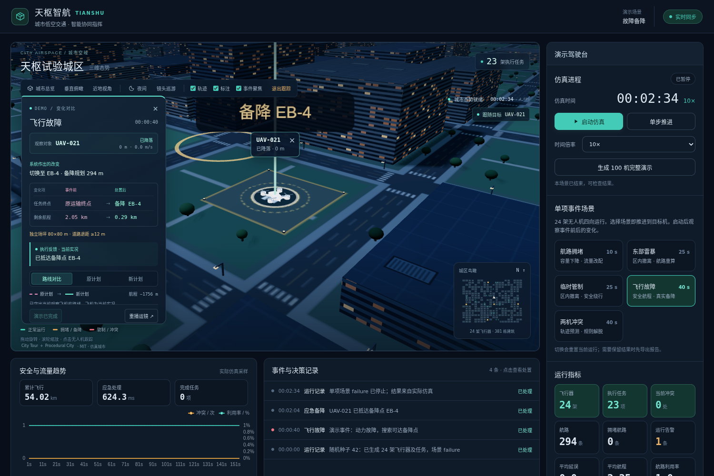

# 自动演示与指标口径

## 单项事件场景

[四向单项 Demo 效果截图](assets/four-way-demo-weather.png)

控制台“单项事件场景”提供航路拥堵、东部雷暴、临时管制、飞行故障和两机冲突五个 Demo。每个 Demo 使用 24 架四向无人机，东、西、北、南各 6 架，按 150、210、270、330 米高度分层，所有任务都有独立的地面终点。点击卡片后停在仿真 0 秒，点击“启动仿真”观看事件前运行、事件触发及后续处置。雷暴和管制区域根据实际飞行位置布置，覆盖在飞无人机并真实执行撤离与改航。事件聚焦会定位实际区域、航路或故障机；也可选择其他无人机跟踪，点击“城市总览”返回总览。切换场景会重置当前运行，可先导出报告。

| 场景参数 | 注入时刻 | 观察重点 | 自动停止 |
| --- | --- | --- | --- |
| congestion | 10 秒 | 航路容量缩减、受影响飞行器改航 | 注入后 80 秒 |
| weather | 25 秒 | 雷暴覆盖在飞无人机，先撤离再改航 | 注入后 80 秒 |
| closure | 25 秒 | 管制覆盖在飞无人机，先撤离再绕行 | 注入后 80 秒 |
| failure | 40 秒 | 故障机剩余航程、备降点及真实降落 | 实际到达备降点后至少 30 秒 |
| conflict | 40 秒 | 两机交汇意图、预测冲突及规则解脱 | 实际解脱后至少 30 秒 |

拥堵、雷暴和管制场景按表中时长停止。故障或冲突场景若到仿真 220 秒仍未出现实际结果，则停止并如实记录；一旦出现实际结果，即使总时长超过 220 秒，也会在结果后继续运行至少 30 秒。可无浏览器生成单项报告，例如：

~~~powershell
.venv-runtime\Scripts\python.exe -X utf8 scripts\run_demo_headless.py --scenario failure --steps 300
~~~

默认分别写到 data/scenarios/ 中对应的 JSON 文件；`--scenario full` 仍默认 100 机和 data/demo_report.json。

四向 Demo 的 seed=42 实测报告已更新到该目录：拥堵影响 1 架并改航；雷暴和临时管制各影响 6 架并全部改航，其中 2 架从区域内实际撤离；故障机在 EB-4 完成备降；两机冲突通过实际轨迹预测和延时让行解脱。对应停止时刻分别为 90、105、105、154、70 仿真秒，结束时均无剩余冲突。所有数量均来自当前版本的实际仿真输出。启动前和每次扰动后的新航路立即接受全机预测间距检查，运行中每个仿真步还会复检实际轨迹；无法安全解脱时暂停运动。手动注入的区域覆盖飞行器时，规划器检查建筑、空域、剩余航程和安全间距，先规划从实际位置飞至区域外的短撤离段，再用 A* 规划余下任务航路。若余下航路暂不可达，飞机仍会先撤离并在安全出口等待；若没有物理可行的安全出口，则告警并暂停该机。

## 完整比赛演示

在控制台生成 100 机演示并启动，或运行仓库根目录的 scripts/run_demo_headless.py。seed=42 只控制初始城市、任务和航路；事件处理结果由引擎推进产生。HTTP /api/simulation/demo 生成并暂停，/start 启动，/pause 保存，/step 精确推进，/report 输出完整事件、指标及历史曲线。

| 仿真时刻 | 输入 | 系统处理 |
| --- | --- | --- |
| 20 秒 | 有流量航路容量收缩到 1 | 更新容量、重建路网、检查受影响任务并重规划或等待 |
| 45 秒 | 东部雷暴 | 更新天气、标记航路、从实际位置重规划 |
| 70 秒 | 飞行中的无人机故障 | 下调可飞距离、选择可达且有容量的备降点、逐步飞行 |
| 95 秒 | 两机任务意图交汇 | 保持实际物理位置，预测器检测冲突并搜索安全解脱 |
| 160 秒 | 演示雷暴消散 | 解除天气约束、恢复可用航路并继续调度 |
| 220 秒 | 扰动注入阶段结束 | 记录阶段完成；任务继续飞行 |

全部任务进入终态或到达 600 秒时自动停止。未解决的临近冲突会暂停；任务无路径会等待并记录告警。demo_complete 只表示四类扰动已执行，不等同于任务全部完成。

总飞行距离为实际推进航段的三维长度之和；平均航程为总距离除以机数。完成任务数只计到达原目的地，备降另记。平均延误按任务创建/完成的仿真时间与初始计划时长计算；未结束任务加当前剩余飞行时间作预计。航路利用率是当前航段占用之和除以容量之和。冲突曲线显示检测到的预测冲突数，当前冲突数显示规则处置后的剩余量。应急处理时间是故障事件从注入到决策记录的实际墙钟时间，不包含飞到备降点的仿真时间。告警数是所有已记录的非信息级事件的累计数。

固定种子的实际报告在 data/demo_report.json；可通过 --seed、--aircraft、--steps 重跑。指标会随种子、硬件、参数和结束时刻变化，不能当作预设得分。100 机仍采用成对轨迹检测和保守包围盒预筛；单 worker 默认目标 10 倍速不保证墙钟达到 10 倍。能耗和天气采用解释性代理模型，目前没有已训练的 AI 决策器。

当前保存的 seed=42、100 机四向报告在仿真 436 秒停止：99 个任务完成、1 架完成真实备降、0 个待处理任务，最终剩余冲突为 0。完整演示仍使用四向真实任务、独立起降点、可达备降点、实际事件处置和逐步间距复检；运行时间与处理耗时会随硬件、参数和负载变化。

## 让观众看清系统改变了什么

选择 Demo 后，镜头在仿真 0 秒就从城市远景推进到后续事件的目标无人机；此时仿真保持暂停。启动后可在同一近景中观看原计划、事件触发和方案改变。同一目标在事件发生后继续跟随，镜头不会再次拉远。开场目标通过复制初始飞行计划并使用真实运动模型预选，结果保存在本次运行记录的 camera_cue 中，不改变实时位置、计划、指标或事件状态；手动改动任务后仍以实际事件选择的目标为准。

[城市远景截图](assets/demo-camera-wide.png) · [目标无人机近景截图](assets/demo-camera-close.png)

页面左侧的演示讲解显示目标机编号、实时高度与速度、事件倒计时，以及“事件前 / 处置后”的并排数值对照。容量、等待时长、任务终点和剩余航程均取自真实决策记录；执行反馈另行显示实际撤离、落地等当前状态。建议先选“东部雷暴”，点击“推进到事件”，再切换“原计划 / 新计划 / 路线对比”；用“讲解播放 · 5×”继续观察两架飞机实际撤出区域。危险区域仍存在时，讲解会明确显示“区域仍生效”。

粉色虚线为事件发生前的剩余飞行计划，青色实线为完成处置后的计划，箭头表示计划方向。每个事件最多展示三架代表飞机，优先选择需要撤离的飞机；受影响飞机高亮，其余飞机降低亮度。可点击代表飞机编号切换观察对象；当前飞机的前后路线保持高亮，其他示例路线降低亮度。近景只保留所选任务的相关终点标注。飞机模型始终显示当前实况位置，路线切换只切换方案图层。冲突场景若路线重合，应观察等待时长和速度的变化；备降场景显示终点切换和实际落地状态。

前后方案在后端决策时保存，随事件持久化；之后飞行不会改变记录。事件记录展开后可点击“在地图中对比这次变化”重新定位。旧事件没有方案记录时只显示原有结果，不补造路线。超过 128 个点的方案不绘制捷径，界面明确提示部分路线未记录。

开场蓝色虚线表示原始计划；事件发生后切换到粉色原计划和青色新计划对比。“原计划 / 新计划 / 路线对比”只切换方案图层，飞机仍显示当前实况。需要重看镜头时可点击“重播运镜”；拖动、缩放或切换视角会立即交还手动控制。

[0 秒开场目标](assets/demo-opening-target.png) · [同一目标的决策变化](assets/demo-opening-changes.png)

## 飞行连续性与备降场地

飞机位置使用统一的缓冲时间轴播放。后端记录每步实际经过的航段拐点和到达时刻，前端沿这些真实航段插值，避免每次收到网络快照时重新减速追赶。播放速度和渲染帧率分开处理；转弯保留实际拐点，不绘制穿越建筑的捷径，也不预测超过最新安全观测位置。暂停和单步会显示后端的精确位置，恢复播放后继续沿真实轨迹运行。模拟网络间隔波动的匀速测试中，5×播放的速度变异系数约为 1.3%；实际帧率仍取决于绘图设备和场景负载。

备降点使用独立的 80×80 米地面场坪。整个场坪与道路及人行道外缘至少间隔 12 米，同时避让建筑、其他地面起降点和已分配的备降场坪。城市生成、后端备降候选校验、三维场坪和小地图使用同一组尺寸及街区坐标；不合格的旧备降点不会被选择。普通改航通过场坪上方的真实空中航段换层，地面节点只作为起终点。场景中的尺寸为演示配置，可在共享的 ground_layout 参数中检查。

故障 Demo 的 seed=42 实测：UAV-021 飞往 EB-4，规划剩余航程约 294 米，在仿真 124 秒真实触地，154 秒结束演示。讲解卡显示实际选择的独立场坪尺寸和道路退距；落地模型与后端地面坐标一致。

